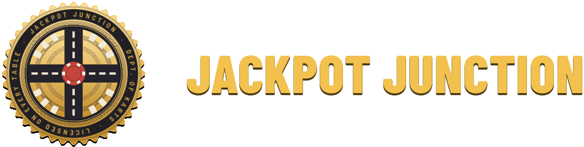

<h1 align="center">
  
</h1>

A top-down arena kart game in which every life is a hand of cards. Drive a
drifty toy kart through a bullet-filled diorama, collect poker-chip coins and
multipliers, and decide when to cash out at the Junction before someone shoots
you.

Made with Godot 4.7 and GDScript. What changed in each release is in
[docs/CHANGELOG.md](docs/CHANGELOG.md); the rest of the documentation is listed under
[Documentation](#documentation).

![The House's invitation on a dark table under two spotlights. On the left lies a cream bulk-mail envelope from THE HOUSE, Jackpot Junction, addressed TO: YOU, with a box of presorted postage, a green road sign stuck over its window reading JACKPOT JUNCTION, NEXT EXIT, ALL ROADS LEAD HERE, and YOU MAY ALREADY BE A WINNER! in red across its foot. On the right, turned a little toward the light so its gold shines, stands a red velvet card edged in gold with rays fanning from its top: GRAND OPENING TONIGHT over JACKPOT JUNCTION in gold, the four suits, "Fast karts. Loud tables. Real chips.", YOU'RE ON THE LIST and "RSVP not required. You'll come.", a gold star sticker offering FREE CHIPS FOR NEW DRIVERS, and below a row of punched holes a gold stub, ADMIT ONE DRIVER, with its number. Under them a single button: Accept the invitation](docs/opening-invitation.png)

*The invitation that brings you to the tables, the first time you start the game.*

Three arenas, three rooms to play them in, and an XL version of each with room to spare.

![A dark card room with a green baize arena on the table in the middle of it, the only lit thing in the room. A roulette wheel of red and black pockets is let into the baize at the center, with stacks of red chips and fanned playing cards round the walls and dice on the cloth beyond them. Neon signs hang over a crowd reduced to shapes with light along their edges, and the match clock glows orange above the far edge. Three players share the screen, a corner each: the first's dashboard is in the top left, in red, the second's in the top right, in blue, and the third's in the bottom left, in yellow, each with their drive hint beside it, the keyboard's and two gamepads'; the first player's hand of jokers is tucked small along the top beside their corner](docs/the-vault.png)

*The Vault, After Hours, three players at one screen.*

![A concrete yard in late afternoon light seen from high above, with a far bigger arena marked out on it than the usual map: two long stepped walls of pale blocks curve toward each other across it, a pit edged in black and yellow hazard stripes sits in each of their bends, and a disc bordered in the same stripes lies in the open middle, with karts small against all that floor. The crowd fills stepped tribunes on every side, with a truck, stacked drums and a forklift beyond them, and lit hoardings and the match clock along the far edge. Beside the clock at the top hangs a slim scrap of paper with a red map pin: the bet the player has pinned in the loyalty program, The Cashier's Cage, 17 of 25 cash-outs along a little road filling in gold. The player's hand is along the bottom](docs/crossfire-xl.png)

*Crossfire XL, in The Yard: the same room around a bigger arena, a loyalty program bet pinned by the clock.*

![A wide phone screen showing Lucky Crossing on The Workbench from above: a green felt arena on a wooden bench, low blocks and pits of spikes about a machined plate in the middle, karts and chips on the cloth, and a crowd packed round it with planks and rod stock beyond. The touch controls are drawn over it in the player's own red: a steering wheel in the lower left for the left thumb, and on the right a round Fire button beside a tall slider cut into Nitro, Gas, Reverse and Drift. The menu button sits in the top right corner over the standings strips, the player's dashboard is in the top left, and their hand of joker cards is along the bottom edge](docs/mobile.png)

*Lucky Crossing on a phone: the stick under the left thumb, Fire and the slider under the right.*

## Installing

Every release has the game for Windows, macOS, Linux and Android: download the
file for your system from the
[latest release](https://github.com/timvisee/jackpot-junction/releases/latest).
There is nothing to install beyond unpacking it.

| System       | Download                             | Then                                       |
|--------------|--------------------------------------|--------------------------------------------|
| Windows      | `jackpot-junction-…-windows.zip`     | Unzip it and run `jackpot-junction.exe`    |
| macOS        | `jackpot-junction-…-macos.zip`       | Unzip it and open the app                  |
| Linux        | `jackpot-junction-…-linux.zip`       | Unzip it and run `./jackpot-junction`      |
| Linux on ARM | `jackpot-junction-…-linux-arm64.zip` | The same                                   |
| Android      | `jackpot-junction-…-android.apk`     | Open it on the phone and allow the install |

The builds are not signed by a store, so the first start asks once: on Windows
choose More info and then Run anyway; on macOS open it, then allow it under
System Settings, Privacy & Security, Open Anyway, or run
`xattr -dr com.apple.quarantine` on the app; on Android let the browser or file
manager you opened it from install apps. To play together online everybody needs
the same major and minor version, such as 0.14.x. A dedicated server is in the same
release too, see [docs/SERVER.md](docs/SERVER.md).

## Playing

- **Single-player**: Play opens the lobby with the match settings over it: a Grand
  Prix or one arena, match length, target score, bots and difficulty. Drive onto
  the pad in the middle to start. Bots use the same karts, items and jokers you do.
- **Teams**: set Teams in the match settings to play in two to four teams that
  bank one score together. In the lobby, stop on a team's corner to join it, or
  use the team button on your switch in the pause menu.
- **Local multiplayer**: in the lobby or mid-match, press Start on a gamepad or
  J on the keyboard to join. Dress your kart at the stalls along the lobby's back
  wall, or under Your kart in the pause menu, and name each seat in Settings, Seats.
- **LAN**: Play LAN, host on a port or join a friend's address directly.
  The host runs the match; joining players take over bot karts.
- **Online**: Play Online, on a dedicated server: make a game there and host it
  from your own machine, or join one somebody else made. See
  [docs/SERVER.md](docs/SERVER.md) to run one.
- **Garage**, under Clubhouse: a practice room with an open floor to drift round the
  Junction on, a range of targets and two dummy karts to shoot at. Stop on its lift to
  dress your kart.
- **Your kart**, under Clubhouse or in the pause menu: your kart in the Garage's bay,
  a pegboard hook for each part to change it, and its color, name and plate.
- **Catalog**, under Clubhouse or on the License page of Settings: every joker and
  power-up you have found, the rest face down.
- **Demo**: start the game with `--demo` after `--`, as in `./jackpot-junction -- --demo`,
  to show it at a booth. It plays Grand Prix after Grand Prix by itself on settings of
  its own, and anybody walking past presses a button to take a seat. Escape opens its
  menu, with Quit to end it.

Default controls, all rebindable in Settings:

| Action               | Keyboard        | Gamepad          |
|----------------------|-----------------|------------------|
| Drive, brake, steer  | W, S, A, D      | Triggers, stick  |
| Fire                 | Space           | A                |
| Handbrake            | Shift           | LB               |
| Nitro                | Ctrl            | RB               |
| Use item             | E               | X                |
| Joker menu           | Tab, 1 to 5     | Y, D-pad         |
| Pause                | Escape          | Start            |

## Documentation

Everything else is in [`docs/`](docs):

| Document                                       | What it holds                                                            |
|------------------------------------------------|--------------------------------------------------------------------------|
| [DEVELOPMENT.md](docs/DEVELOPMENT.md)          | Building, running and testing from a checkout, startup and debug arguments, the tools, releasing |
| [SERVER.md](docs/SERVER.md)                    | Running a dedicated server, on its own or with Docker                     |
| [GAME.md](docs/GAME.md)                        | The design, which the code cites by section, "GAME.md 3.8"                |
| [STORY.md](docs/STORY.md)                      | The story under it (spoilers)                                            |
| [PLAN.md](docs/PLAN.md)                        | The implementation plan, with the status of every milestone              |
| [CHANGELOG.md](docs/CHANGELOG.md)              | What changed in each release                                             |
| [house-print](docs/house-print/index.html)     | The art direction of the UI, House Print                                 |

## License

The source code is licensed under the GPL-3.0, see `LICENSE`. Assets made for
the game are licensed under CC-BY-4.0. Third-party assets and libraries keep
their own licenses and are listed in `THIRD_PARTY.md`. The music is licensed
from Ovani Sound to this game's developer and is not covered by either
license.
